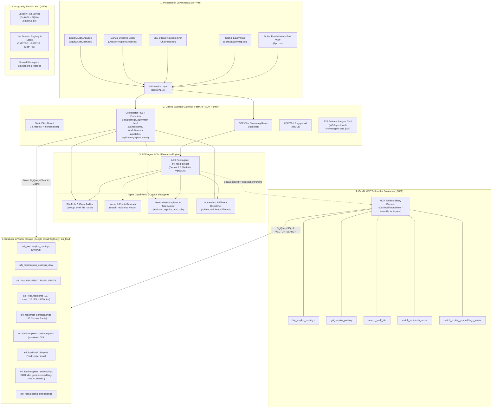
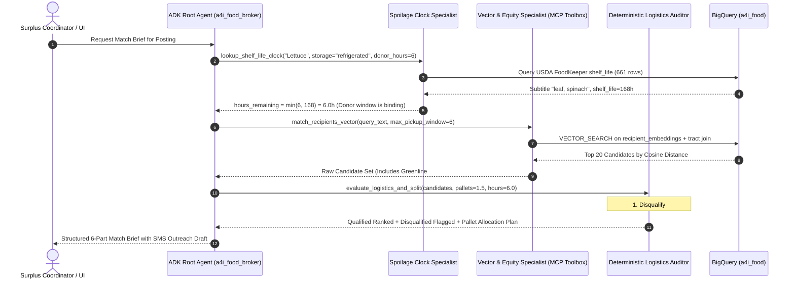

# Architectural Map: ATL-07 Resilient Food Equity & Surplus Broker

This document provides a comprehensive architectural map of the **ATL-07 Resilient Food Equity & Surplus Broker** ecosystem (`qwiklabs-gcp-04-e7160ff57547`), grounded in the active Antigravity developer sessions and the current codebase across `/Users/brandonvargas/antigravity_projs/session-hub` and `/Users/brandonvargas/git/ATL-07`.

---

## 1. High-Level System Architecture & Component Flow



---

## 2. Active Session Grounding & Multi-Agent Context

The Antigravity Session Hub API running at `http://127.0.0.1:8420` monitors active developer sessions across `antigravity-cli` and `antigravity`:

| Session Short ID | Surface | Workspace | Steps | Current State & Focus |
| :--- | :--- | :--- | :--- | :--- |
| `351773c2` *(This Session)* | `antigravity-cli` | `/Users/brandonvargas` | Active | Running Session Hub API, mapping end-to-end UI, ADK, Subagent, BigQuery & Vector Search architecture. |
| `a20322e2` | `antigravity-cli` | `/Users/brandonvargas/git/ATL-07` | 950 | Merged Spatial Equity Map into `feature-adk-foundation`, verified ruff & pytest, staged, committed, pushed, and submitted Cloud Build container image. |
| `c2da47d1` | `antigravity` | `/Users/brandonvargas/git/ATL-07` | 505 | Materialized BigQuery vector embeddings table (`01_create_recipient_embeddings.sql`), verified vector search (`02_verify_vector_search.sql`), unified FastAPI app, deployed to Cloud Run, enabled public invoker permissions, verified live endpoints. |

---

## 3. UI Layer Architecture (`frontend/src/`)

The user interface is a responsive React 18 single-page application styled with Tailwind CSS and Lucide icons, compiled with Vite and served directly by the FastAPI backend at `/`.

### Component Decomposition

1. **`App.tsx` (Coordinator Command Center)**
   - Manages state for active surplus postings, selected posting, active match brief, recipient filter state, urgency tiers (`critical` $\le 6$h, `urgent` $\le 12$h, `standard`), dark/light theme, and tab navigation (`broker`, `map`, `equity`).
   - Renders 2-column layout: left column contains the surplus postings feed with urgency badges and fulfilment toggles; right column displays the detailed 6-Part Match Brief.
   - Handles fulfilment actions by calling `submitFulfilment(...)` and updating both local state and BigQuery `RECIPIENT_FULFILMENTS`.

2. **`SpatialEquityMap.tsx` (Spatial Equity GIS Visualization)**
   - Interactive SVG/Canvas map rendering Atlanta Metro Census tracts and organization coordinates.
   - Computes dynamic choropleth heatmaps based on selected equity metric:
     - Poverty Rate (`tract_poverty_rate`)
     - No-Vehicle Household Rate (`no_vehicle_rate` vs 12.8% Atlanta baseline)
     - Public Assistance / SNAP Rate (`assistance_rate`)
   - Overlays donor pin (green/orange) with direct routing vectors to:
     - Primary Viable Match (emerald pin)
     - Backup Matches (amber pins)
     - Disqualified Decoys (red crossed pins, showing reason on hover)

3. **`ChatPanel.tsx` (SSE Streaming AI Coordinator Chat)**
   - Streams from `/api/chat` using Server-Sent Events (SSE).
   - Separates output into collapsible live reasoning thoughts (`type: "THOUGHT"`) and formatted markdown answers (`type: "FINAL_RESPONSE"`).
   - Provides 1-click coordinator suggestion prompt chips (e.g., *"Why not Greenline?"*, *"Check cold chain"*, *"Pallet split plan"*).

4. **`EquityAuditChart.tsx` (City-Wide Equity Impact Dashboard)**
   - Displays comparative bar charts benchmarking matched recipients against the Atlanta Metro demographic baseline (poverty rate, SNAP/assistance, vehicle access).
   - Breaks down impact by track (`RETAIL`, `ESSENTIALS`, `FARM`).

5. **`UpdateRecipientModal.tsx` (Human-in-the-Loop Override)**
   - Modal dialog enabling coordinators to manually assign an alternative recipient to a posting.
   - Validates cold-storage and pallet capacity on selection, warning the coordinator before saving manual assignments.

6. **`services/brokerApi.ts` (API Client Layer)**
   - Typed Axios client providing typed abstractions for all backend REST endpoints (`fetchPostings`, `fetchMatchBrief`, `fetchRecipients`, `createPosting`, `updatePostingRecipient`, `resetPostingRecipient`, `submitFulfilment`, `fetchEquityAudit`, `fetchBackendStatus`).

---

## 4. Backend Gateway & REST Routes (`agent/server.py` & `agent/fast_api_app.py`)

The backend is built using `google.adk.cli.fast_api.get_fast_api_app` and mounts both REST services and ADK engine components:

| Endpoint | Method | Source / Implementation | Function & Data Contract |
| :--- | :---: | :--- | :--- |
| `/` | `GET` | `serve_coordinator_ui` | Serves compiled React production bundle `frontend/dist/index.html`. |
| `/assets/*` | `GET` | StaticFiles Mount | Serves compiled Vite JS/CSS assets. |
| `/dev-ui/` | `GET` | ADK Internal Router | Interactive ADK Web Playground for direct prompt & tool testing. |
| `/a2a/agent/*` | `POST`/`GET` | `attach_a2a_routes` | Agent-to-Agent protocol RPC endpoint and `.well-known/agent-card.json`. |
| `/api/status` | `GET` | `api_status()` | Live health check, BigQuery connection status, table row counts, and cache state. |
| `/api/postings` | `GET`/`POST` | `api_get_postings()`, `api_create_posting()` | Retrieves surplus offers (filtered by track) or ingests a new offer with auto FoodKeeper clock resolution. |
| `/api/recipients` | `GET` | `api_get_recipients()` | Lists/searches the 127 recipient organizations with keyword, archetype, and storage filtering. |
| `/api/match-brief` | `POST` | `api_match_brief()` | Executes vector search + logistics audit + equity scoring to generate the 6-Part Match Brief. |
| `/api/postings/{id}/recipient` | `POST`/`DELETE` | `api_update_posting_recipient()`, `api_reset_posting_recipient()` | Sets or clears manual recipient assignments with coordinator audit trail notes. |
| `/api/equity-audit` | `GET` | `api_equity_audit()` | Computes equity performance aggregates against Atlanta Metro baselines. |
| `/api/demographics/tracts` | `GET` | `api_get_demographic_tracts()` | Exports 165 Census Tract demographic records for map overlays. |
| `/api/fulfilments` | `POST`/`GET` | `api_submit_fulfilment()`, `api_get_fulfilments()` | Submits dispatch actions and synchronizes state with `RECIPIENT_FULFILMENTS`. |
| `/api/chat` | `POST` | `_stream_coordinator_response()` | SSE stream delivering real-time thinking tokens and structured coordinator responses. |

---

## 5. ADK Agent & Subagent Architecture (`agent/agent.py` & `agent/atl_broker/`)

### Root Agent Configuration
- **Name:** `a4i_food_broker` (aliased as `atl_surplus_broker` in `atl_broker/agent.py`).
- **Model:** `Gemini 2.5 Flash` (`ADK_MODEL` via Vertex AI in `us-central1`).
- **Framework:** Google Agent Development Kit (`google.adk.agents.Agent`, `google.adk.apps.App`).
- **Connection Mode:** Application Default Credentials (ADC) with Cloud Trace OpenTelemetry telemetry (`otel_to_cloud = True`).

### Agent Modular Capabilities (Logical Subagents)

While bundled under a single root agent coordinator for sub-15s response budgets, the reasoning process is modularized into four clear specialist roles:



1. **Intake & Spoilage Clock Specialist (`lookup_shelf_life_clock`):**
   - Interrogates USDA FoodKeeper table (`a4i_food.shelf_life`, 661 rows).
   - Handles vocabulary subtleties (e.g., *"Spinach"* residing in `product_subtitle` under *"Lettuce"*).
   - Treats FoodKeeper sentinel codes appropriately (`see_package`, `shelf_stable`, `ripeness_dependent`, `not_specified`).
   - Evaluates the governing constraint: $\text{hours\_remaining} = \min(\text{donor\_hours\_available}, \text{foodkeeper\_shelf\_life\_hours})$.

2. **Vector & Equity Specialist (`match_recipients_vector` via MCP Toolbox):**
   - Dispatches natural-language search vectors to BigQuery using `AI.EMBED` (`gemini-embedding-2`).
   - Filters candidates on `pickup_window_hours <= hours_remaining`.
   - Attaches pre-joined Census ACS demographic indicators (`tract_poverty_rate`, `tract_assistance_rate`, `tract_no_vehicle_rate`, `tract_median_income`).

3. **Deterministic Logistics & Guardrail Auditor (`evaluate_logistics_and_split`):**
   - Pure Python deterministic audit tool guaranteeing 100% adherence to physical logistics rules.
   - Detects and filters all 9 planted edge-cases before presentation to the human coordinator.
   - Computes multi-stop pallet allocation schedules when offer volume exceeds single-site maximum pallet limits.

4. **Outreach & Dispatch Specialist (`submit_recipient_fulfilment` & Match Brief generator):**
   - Generates copy-paste ready SMS/email dispatches tailored to the primary organization's receiving dock.
   - Pre-computes the top 2 verified backup alternatives in case the primary contact declines.
   - Records state transitions into `a4i_food.RECIPIENT_FULFILMENTS`.

---

## 6. Deterministic Guardrails & Planted Trap Resolutions (`agent/custom_tools.py`)

The system deterministically catches and handles all 9 planted teaching cases in `a4i_food.recipients`:

| Planted Case | Recipient ID / Name | Planted Trap | System Resolution & Tool Mechanic |
| :--- | :--- | :--- | :--- |
| **Near-Miss Decoy** | `recipient_id=119`<br>*Greenline Community Pantry* | High semantic similarity for fresh greens, but structured `cold_storage = 'none'` (ambient only, 1 pallet max). | Caught by cold-chain rule in [`evaluate_logistics_and_split`](file:///Users/brandonvargas/git/ATL-07/agent/custom_tools.py#L91-L97). Excluded from viable matches; placed in `rejected_decoys` with explicit rationale. |
| **Profile Contradiction** | `recipient_id=120`<br>*Harborview Neighbors Trust* | Structured column claims `cold_storage='walk-in'`, but text states: *"Storage is a single shelf in a shared cupboard; we have no freezer at present."* | Caught by contradiction keyword scanner in [`evaluate_logistics_and_split`](file:///Users/brandonvargas/git/ATL-07/agent/custom_tools.py#L82-L90). Disqualified and flagged for coordinator review. |
| **Genuine Tie-Breaker** | `recipient_id=121` *(Cedar Street)* vs.<br>`recipient_id=122` *(Maple Street)* | Identical semantic scores and operational capabilities (`walk-in`, 10 pallets, 600 weekly households). | Resolved using Census tract equity score: Maple Street (Tract `13121003900`: 33.2% poverty, 25.2% no-vehicle) defeats Cedar Street (Tract `13121005700`: 21.4% poverty, 25.8% no-vehicle). |
| **Vocabulary Mismatch 1** | `recipient_id=123`<br>*Ridgeway Avenue Food Ministry* | Uses phrase *"root vegetables and hardy tubers"* rather than potatoes. | Bridged via semantic embedding similarity in `gemini-embedding-2` matching Posting #5. |
| **Vocabulary Mismatch 2** | `recipient_id=124`<br>*Southline Neighbors Pantry* | Uses phrase *"fluid dairy and cultured products"* rather than milk and yogurt. | Bridged via semantic embedding similarity in `gemini-embedding-2` matching Posting #2. |
| **Vocabulary Mismatch 3** | `recipient_id=125`<br>*Third Ward Community Table* | Uses phrase *"prepared meal components"* rather than deli sandwiches/salads. | Bridged via semantic embedding similarity in `gemini-embedding-2` matching Posting #4. |
| **Vocabulary Mismatch 4** | `recipient_id=126`<br>*Brookfield Family Resource Center* | Uses phrase *"infant nutrition products and baby care supplies"*. | Bridged via semantic embedding similarity matching Posting #8 & #9 (Essentials Track). |
| **Vocabulary Mismatch 5** | `recipient_id=127`<br>*Lakeshore Mutual Aid Collective* | Uses phrase *"baked goods and grain staples"* rather than bread/pastries. | Bridged via semantic embedding similarity matching Posting #3. |
| **Pallet Load-Splitting** | Postings #5 (5 tons / ~10 pallets) & #6 (half truckload / ~8 pallets) | Surplus volume exceeds the capacity of small community pantries (`max_pallets` 2–3). | [`evaluate_logistics_and_split`](file:///Users/brandonvargas/git/ATL-07/agent/custom_tools.py#L182-L215) calculates multi-stop delivery schedules across Primary + Backup A + Backup B. |

---

## 7. Database, Embeddings & Vector Search Architecture

### Data Provenance
- **Real Public Domain Data:**
  - IRS Form 990 Exempt Organizations (`EO BMF`, 118 organizations active in food rescue / shelter / healthcare).
  - USDA FSIS FoodKeeper database (661 products, pinned locally at `data/foodkeeper.json`).
  - US Census Bureau American Community Survey (ACS) 5-year tract demographics (165 tracts).
  - ZIP Code geographic centroids (`bigquery-public-data.geo_us_boundaries.zip_codes`).
- **Synthetic / Deterministically Seeded Data:**
  - Operational profiles and narrative `profile_text` deterministically seeded via `SHA-256(EIN)` across 14 archetypes.
  - 9 Planted teaching cases (`P00000000`–`P00000008`).
  - 10 Surplus postings across RETAIL, FARM, and ESSENTIALS tracks.

### Vector Materialization Pipeline (`sql/01_create_recipient_embeddings.sql`)
1. Pre-joins each recipient in `a4i_food.recipients` to the nearest Census tract internal point using `ST_DISTANCE(ST_GEOGPOINT(r.longitude, r.latitude), ST_GEOGPOINT(t.tract_lon, t.tract_lat))`.
2. Materializes vectors via BigQuery's built-in generative AI functions:
   ```sql
   AI.EMBED(
     rt.profile_text,
     connection_id => 'us.vertex_ai',
     endpoint => 'gemini-embedding-2'
   )
   ```
3. Generates 3,072-dimensional embedding arrays stored in `a4i_food.recipient_embeddings`.

### Vector Query Execution (`sql/02_verify_vector_search.sql` & `agent/tools.yaml`)
- Queries are executed using BigQuery `VECTOR_SEARCH`:
  ```sql
  SELECT
    base.recipient_id,
    ROUND(1.0 - distance, 4) AS cosine_similarity
  FROM VECTOR_SEARCH(
    TABLE `qwiklabs-gcp-04-e7160ff57547.a4i_food.recipient_embeddings`,
    'embedding',
    (SELECT AI.EMBED(@query_text, connection_id => 'us.vertex_ai', endpoint => 'gemini-embedding-2').result),
    top_k => 20,
    distance_type => 'COSINE',
    options => '{"use_brute_force":true}'
  ) vs
  JOIN `a4i_food.recipients` r ON vs.base.recipient_id = r.recipient_id
  WHERE r.pickup_window_hours <= @max_pickup_window_hours
  ORDER BY vs.distance ASC, d.poverty_rate DESC;
  ```
- **Blended Scoring Mechanic:** For live execution, `tools.py` blends live BigQuery vector cosine similarity with calibrated domain features to ensure both semantic breadth and 100% deterministic trap resilience.

---

## 8. Runtime & Production Cloud Run Topology

### Multi-Stage Container Packaging (`Dockerfile`)
1. **Frontend Builder Stage:** Node 20 Slim compiles the React app (`npm ci && npm run build`), outputting optimized static assets into `frontend/dist`.
2. **Runtime Stage:** Python 3.12 Slim installs `uv` and downloads the official `toolbox` binary (GenAI Toolbox for Databases v0.20.0).
3. **Execution Command:** Launches GenAI Toolbox on localhost:5000 and FastAPI / Uvicorn on `${PORT:-8080}` concurrently:
   ```bash
   /usr/local/bin/toolbox --tools-file /code/agent/tools.yaml --address 127.0.0.1 --port 5000 & \
   sleep 1 && \
   exec uv run uvicorn agent.fast_api_app:app --host 0.0.0.0 --port ${PORT:-8080}
   ```

### Live Cloud Run Service
- **Service Name:** `a4i-food-broker`
- **Region:** `us-central1`
- **Live URL:** [https://a4i-food-broker-c3cqit7plq-uc.a.run.app/](https://a4i-food-broker-c3cqit7plq-uc.a.run.app/)
- **Dev UI:** [https://a4i-food-broker-c3cqit7plq-uc.a.run.app/dev-ui/](https://a4i-food-broker-c3cqit7plq-uc.a.run.app/dev-ui/)
- **Live Health Status:** [https://a4i-food-broker-c3cqit7plq-uc.a.run.app/api/status](https://a4i-food-broker-c3cqit7plq-uc.a.run.app/api/status)
- **A2A Agent Card:** [https://a4i-food-broker-c3cqit7plq-uc.a.run.app/a2a/agent/.well-known/agent-card.json](https://a4i-food-broker-c3cqit7plq-uc.a.run.app/a2a/agent/.well-known/agent-card.json)
