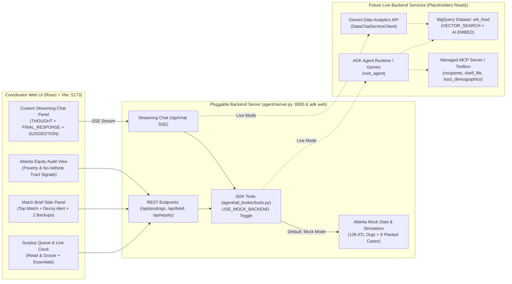

# Atlanta Food Equity & Surplus Broker (`ATL-07`) — Frontend & ADK Implementation Plan

## 1. Goal & Scope

Design and build the custom frontend application (`React + Vite`), custom streaming coordinator chat interface, and ADK (`adk web`) agent scaffolding for **Challenge 2: Resilient Food Equity & Surplus Broker** focused on **Atlanta, GA**, targeting:

- **City / Metro:** **Atlanta, GA** (`LAT: 33.55..33.92`, `LON: -84.55..-84.28` · 126 IRS organizations + 9 planted teaching cases = 135 corpus rows · 13% population-weighted no-vehicle household baseline).
- **Primary Track:** 🛒 **Retail & Grocer Rescue** (small, unpredictable, mixed perishable offers—leafy greens, dairy, bakery, prepared deli items—under a tight 4–24 hour clock).
- **Stretch Goal Track:** 🍼 **Critical Non-Food Essentials** (infant formula, diapers/wipes sizes 1–4, and temperature-sensitive clinical nutritional supplements requiring strict chain-of-custody, medical cold storage, or diaper bank capabilities).
- **Custom Streaming Coordinator Chat Interface:** A dedicated slide-out / split-view chat panel (`ChatPanel.tsx`) supporting Server-Sent Events (SSE) streaming, segregated **Thinking Process** (`THOUGHT`) vs. **Final Answer** (`FINAL_RESPONSE`), dynamic follow-up **Suggestion Pills** (`SUGGESTION`), multi-turn conversation history, and active posting context.
- **Pluggable Backend Placeholders:** Because BigQuery (`a4i_food`), `VECTOR_SEARCH`, and the managed MCP server are not yet wired up, this architecture introduces a clean **Service & Adapter Layer** pre-populated with realistic Atlanta mock data (matching the exact BigQuery schemas and planted edge cases from [`notebooks/c2_01_load_explore.ipynb`](../notebooks/c2_01_load_explore.ipynb)) so the custom UI, streaming chat, and `adk web` work immediately today and can switch to live backend services via environment variables (`USE_MOCK_BACKEND=false`).

---

## 2. Technical Tradeoffs: Custom Web UI (`React + Vite`) vs. Built-In `adk web`

Building a custom UI alongside our ADK agent is strongly encouraged by the challenge [`README.md`](../README.md) (which notes that shipping raw `adk web` alone is a weak product story for a food-rescue coordinator at 4pm on a Thursday). Below are the technical tradeoffs and how this plan mitigates them:

| Dimension | Built-In `adk web` Only | Custom UI (`React + Vite`) + FastAPI/ADK Backend | How This Plan Mitigates the Tradeoff |
|---|---|---|---|
| **Product & Judge Experience** | Developer-centric trace/chat debugger; lacks a coordinator queue, live countdown clocks, side-by-side decoy comparison, or Equity Audit charts. | Purpose-built for a food-rescue coordinator at 4pm on a Thursday: ticking clocks, one-click *"They said no"* fallback routing, Retail vs. Essentials track switching, and custom streaming chat. | Keeps `agent/` 100% compatible with `adk web` for debugging tool traces while shipping `frontend/` as the primary Coordinator UI. |
| **Process & Dev Server Complexity** | Single CLI command (`adk web agent`). | Requires running a frontend dev server (`Vite` on `:5173`) alongside the Python API server (`FastAPI` on `:8000`) and handling CORS / proxying. | Configures Vite's built-in `/api` proxy to forward to `:8000` **and** adds a seamless client-side fallback in `frontend/src/services/brokerApi.ts` so the UI never breaks even if the Python server is stopped. |
| **Streaming & Session State** | Handled internally by ADK's built-in web client. | Custom UI must parse SSE streams (`text/event-stream`), track multi-turn `history`, separate internal agent reasoning (`THOUGHT`) from `FINAL_RESPONSE`, and pass active posting context. | Implements a dedicated `/api/chat` SSE endpoint in `agent/server.py` and a battle-tested `ChatPanel.tsx` with an `ErrorBoundary`, collapsible thought drawer, and suggestion pills. |
| **Schema Contract Maintenance** | Untyped text in/out in a chat bubble. | Structured UI cards (Match Brief, Clock, Equity Audit) require strict JSON contracts between backend tools and TypeScript components. | Mirrors the exact column names of the 4 BigQuery tables (`recipients`, `surplus_postings`, `shelf_life`, `tract_demographics`) in both Python and TypeScript from day one. |

---

## 3. Architecture & Placeholder Strategy

### Exact BigQuery Schemas Mirrored in Placeholders
To guarantee zero friction when the Data and Agent lanes finish setting up BigQuery (`a4i_food`), all placeholder models and TypeScript/Python interfaces strictly match the schemas from [`notebooks/c2_01_load_explore.ipynb`](../notebooks/c2_01_load_explore.ipynb):

| Table (`a4i_food.*`) | Key Fields Mirrored in Placeholders | Atlanta Specifics Included |
|---|---|---|
| `recipients` | `recipient_id`, `ein`, `name`, `street`, `city`, `state`, `zip_code`, `ntee_code`, `archetype`, `archetype_label`, `cold_storage`, `frozen_storage`, `loading_dock`, `refrigerated_transport`, `max_pallets`, `pickup_window_hours`, `weekly_households`, `reported_income`, `populations_served`, `service_days`, `profile_text`, `profile_source`, `latitude`, `longitude` | Real-shaped Atlanta metro coordinates (`33.55..33.92`, `-84.55..-84.28`), plus the planted teaching cases: **Greenline Community Pantry** (near-miss decoy: wants greens, `cold_storage='none'`), **Harborview Neighbors Trust** (contradiction), **Cedar Street / Maple Street Produce Alliance** (genuine tie broken by Atlanta tract need), and vocabulary-mismatch organizations. |
| `surplus_postings` | `posting_id`, `track` (`RETAIL`, `ESSENTIALS`, `FARM`), `posting_text`, `foodkeeper_product`, `storage_state`, `hours_available`, `shelf_life_hours`, `hours_remaining` | Pre-loaded with the 4 Retail & Grocer postings (spinach, milk/yogurt, day-old bread, deli sandwiches) + 3 Critical Non-Food Essentials stretch-goal postings (sealed infant formula, diapers/wipes sizes 1–4, cold-chain clinic nutritional supplements), plus ability to submit custom postings. |
| `shelf_life` | `product_id`, `product_name`, `product_subtitle`, `keywords`, `category`, `refrigerated_hours`, `refrigerated_note`, `pantry_hours`, `pantry_note` | Handles USDA FoodKeeper subtleties (e.g., `"Spinach"` as subtitle on `"Lettuce"`, `"package use-by date"` sentinel on `"Milk"`, and sealed formula keeping its donor clock). |
| `tract_demographics` | `geo_id` (11-char FIPS starting with `13` for GA), `tract_lat`, `tract_lon`, `total_pop`, `median_income`, `poverty_rate`, `no_vehicle_rate`, `assistance_rate` | Reflects Atlanta's ~13% metro no-vehicle baseline and neighborhood spread (e.g., West End, South Atlanta, Bankhead, English Avenue, Midtown, Decatur) for tie-breaking and the Equity Audit. |

---

## 4. Planned Components & File Structure

### Component 1: ADK Agent & FastAPI Placeholder/Live Backend (`agent/`)

Provides both an immediately runnable `adk web` agent (`adk web agent`) and a unified FastAPI backend (`agent/server.py`) exposing REST endpoints and the `/api/chat` SSE streaming endpoint with clean `# TODO(backend)` hooks.

- **`agent/atl_broker/__init__.py`**: Exports `root_agent` as required by `adk web` and `adk api_server`.
- **`agent/atl_broker/config.py`**: Central configuration with environment variable toggles:
  - `USE_MOCK_BACKEND` (defaults to `true` until BigQuery/MCP are configured)
  - `GOOGLE_CLOUD_PROJECT`, `BQ_DATASET="a4i_food"`, `BQ_LOCATION="US"`, `EMBED_ENDPOINT="gemini-embedding-2"`
  - `MCP_TOOLBOX_URL` placeholder for the managed MCP server / MCP Toolbox for Databases
  - `METRO="Atlanta"`, `STATE="GA"`, `PRIMARY_TRACK="RETAIL"`, `STRETCH_TRACK="ESSENTIALS"`
- **`agent/atl_broker/mock_data.py`**: Realistic Atlanta placeholder dataset covering:
  - Atlanta Retail & Grocer recipients (`neighborhood_pantry`, `soup_kitchen`, `mobile_pantry`, `produce_coop`, `regional_foodbank`, `senior_meals`, `halal_kosher`)
  - Atlanta Critical Non-Food Essentials recipients (`diaper_bank`, `community_clinic`, `shelter_kitchen`)
  - Planted hard cases (`Greenline Community Pantry` decoy, `Harborview Neighbors Trust` contradiction, `Cedar Street` & `Maple Street Produce Alliance` tie, and vocabulary-mismatch cases)
  - All Retail & Grocer and Critical Essentials `surplus_postings`, `shelf_life` entries, and Atlanta `tract_demographics`.
- **`agent/atl_broker/tools.py`**: Custom Python function tools for the ADK agent with clear `# TODO(backend): Replace mock branch with BigQuery / MCP call` blocks and working SQL templates from Section 14 of the notebook:
  1. `search_and_filter_recipients(posting_text: str, track: str, required_storage: str, pallets_needed: float, hours_remaining: float)`
  2. `lookup_shelf_life_clock(product_query: str, storage_state: str, donor_hours: float)`
  3. `get_tract_equity_context(recipient_id: int)` & `run_equity_audit(track: str)`
  4. `assemble_match_brief(posting_id: int, excluded_recipient_ids: list[int] = [])`
- **`agent/atl_broker/agent.py`**: Defines the ADK `Agent` (`atl_surplus_broker`) with system instructions tailored to an Atlanta food-rescue coordinator covering the 7 coordinator questions, Retail & Grocer Rescue rules, Critical Non-Food Essentials safety rules, and refusal behavior when no recipient can safely hold the load.
- **`agent/server.py`**: FastAPI backend server (`uvicorn agent.server:app --port 8000`) providing:
  - `GET /api/status`: Returns current mode (`mock` vs. `live`), metro metadata, and connected service placeholders (`BigQuery a4i_food`, `VECTOR_SEARCH`, `MCP Toolbox`, `ADK Agent`).
  - `GET /api/postings` & `POST /api/postings`: Lists or creates Retail & Grocer and Critical Non-Food Essentials postings with computed `hours_remaining`.
  - `POST /api/match-brief`: Runs `assemble_match_brief(posting_id, excluded_recipient_ids)` to return the top recipient, rejected near-miss decoys (with reasons), clock margin, tract equity metrics, outreach draft, and next 2 backups.
  - `GET /api/equity-audit`: Returns tract-level equity comparison (`poverty_rate`, `no_vehicle_rate`, `assistance_rate`) vs. the Atlanta metro baseline (13% no-vehicle rate).
  - `POST /api/chat` (**SSE Streaming Chat Endpoint**):
    - Accepts `{ messages: [{ role, content }], active_posting_id?: number, track?: string }`.
    - Streams `text/event-stream` payloads (`data: {"type": "THOUGHT" | "FINAL_RESPONSE" | "SUGGESTION", "content": "..."}\n\n`).
    - **Mock Mode (`USE_MOCK_BACKEND=true`)**: Streams realistic multi-step agent reasoning (`THOUGHT`: e.g., checking USDA FoodKeeper shelf life, running `VECTOR_SEARCH` on `a4i_food.recipients`, filtering out *Greenline Community Pantry* due to `cold_storage='none'`, comparing Atlanta tract no-vehicle rates), followed by a rich Markdown `FINAL_RESPONSE` and 2–3 contextual follow-up `SUGGESTION` pills.
    - **Live Mode (`USE_MOCK_BACKEND=false`)**: Ready-to-use implementation wired for both the ADK `Runner` (`atl_surplus_broker`) and the Gemini Data Analytics API (`DataChatServiceClient` configured with `inline_context.datasource_references.bq.table_references` for `a4i_food.recipients`, `a4i_food.surplus_postings`, `a4i_food.shelf_life`, and `a4i_food.tract_demographics`).

---

### Component 2: Custom Coordinator Web Application (`frontend/`)

A responsive **React + Vite + Tailwind CSS + Apache ECharts** web application designed for an Atlanta Food & Essentials Rescue Coordinator (`DM Sans`, `JetBrains Mono`, Zinc light/dark theme).

- **`frontend/package.json` & Vite/Tailwind Config**: Sets up React 18, Vite (with `/api` proxy to `http://localhost:8000`), Tailwind CSS (`@tailwindcss/typography`), `lucide-react`, `date-fns`, `axios`, `echarts`, `echarts-for-react`, `react-markdown`, `remark-gfm`, and `@dnd-kit/core` / `@dnd-kit/sortable`.
- **`frontend/src/services/brokerApi.ts`**: Pluggable frontend service client:
  - Connects to `/api/*` (proxied to `http://localhost:8000`) with automatic client-side fallback to the deterministic Atlanta mock engine if the backend server is offline.
  - Exposes typed methods for postings, Match Briefs, *"They said no"* fallback routing, Equity Audit data, Backend Placeholder Inspector status, and SSE chat streaming.
- **`frontend/src/components/ChatPanel.tsx`**: Custom Gemini & ADK Coordinator Chat Drawer:
  - **SSE Stream Reader**: Reads `THOUGHT`, `FINAL_RESPONSE`, and `SUGGESTION` chunks in real time.
  - **Thought vs. Final Response Segregation**: Renders agent tool-call and reasoning steps (`THOUGHT`) inside a collapsible `details` accordion whose summary title dynamically updates to the latest non-empty reasoning line while streaming (`animate-pulse`), keeping the final Markdown answer clean.
  - **Safe Markdown Rendering**: Uses `ReactMarkdown` with `remarkGfm` wrapped inside an `ErrorBoundary` and a styled parent `
`.
  - **7 Coordinator Questions & Dynamic Suggestion Pills**: Pre-seeded with the 7 core coordinator questions from the README (*"Who should get this?"*, *"Why them and not Greenline Community Pantry?"*, *"What's the clock on this?"*, *"They said no — who's next?"*, *"Write the outreach message"*, *"Compare Cedar Street vs. Maple Street tie"*, *"Did our matches go where Atlanta's need is?"*) plus context-aware follow-up pills emitted after each answer.
  - **Auto-Resizing Input**: Multiline `<textarea>` that dynamically adjusts height and submits on `Enter` (allowing `Shift+Enter` for newlines).
- **`frontend/src/App.tsx` & Dashboard Views**:
  1. **Header & Track / Backend Status Bar:**
     - Atlanta Metro badge (`Atlanta, GA · 126 IRS Orgs + 9 Planted · 13% No-Vehicle Baseline`).
     - Track Switcher (`All Tracks`, `🛒 Retail & Grocer Rescue`, `🍼 Critical Non-Food Essentials (Stretch)`).
     - **Backend Placeholders Status Drawer Trigger** (shows exact connection status & env vars needed for `BigQuery a4i_food`, `VECTOR_SEARCH`, `MCP Server`, and `ADK Agent`).
     - **Coordinator AI Chat Toggle Button** & Light/Dark Mode Toggle.
  2. **KPI Summary Cards Row (4 Cards):**
     - Active Urgent Postings (under 8h clock), Pallets / Cases Ready to Broker, High-Need Atlanta Tracts Reached (`No-Vehicle %` vs. 13% Metro Avg), Cold-Chain / Safety Compliance Rate (Decoys Caught).
  3. **Main Split View — Coordinator Surplus Queue + Interactive Match Brief + Custom Chat Panel:**
     - **Surplus Queue Table & New Offer Modal:** Displays Retail & Grocer and Critical Non-Food Essentials offers, storage badges (`refrigerated`, `pantry`, `medical`), visual Countdown Clock progress bars (`hours_remaining`), Top Matched Recipient preview, and ability to post a new offer (or test planted edge cases in one click).
     - **Interactive Match Brief Panel:**
       - **Primary Recipient & Address** + Archetype badge (`neighborhood_pantry`, `produce_coop`, `diaper_bank`, `community_clinic`, etc.).
       - **Why Them & Decoy / Contradiction Alert:** Shows semantic match + operational verification (`cold_storage`, `max_pallets`, `refrigerated_transport`), and explicitly highlights **rejected near-miss decoys** (e.g., *Greenline Community Pantry* rejected due to `cold_storage = none`, *Harborview Neighbors Trust* flagged for profile contradiction) and **tie-breakers** (*Cedar Street* vs. *Maple Street Produce Alliance*).
       - **The Clock & Margin:** Donor hours vs. USDA FoodKeeper shelf life, recipient pickup window, and safety buffer.
       - **Who It Helps (Atlanta Equity Signal):** Census tract poverty rate, no-vehicle household rate (compared to Atlanta's 13% baseline), and SNAP/assistance rate.
       - **Drafted Outreach Message:** Copyable coordinator outreach note + *"Refine in Chat"* shortcut.
       - **"They Said No — Route to Next Option" Button & Next 2 Ranked Backups:** One-click decline logs the rejection reason and promotes Backup #1 (or proposes a multi-stop split load for small Retail/Essentials offers).
  4. **Atlanta Equity Audit & Architecture Readiness View (Apache ECharts):**
     - Full-width (`grid-cols-1`) interactive ECharts bar/scatter comparison of matched Atlanta recipients' census tracts against the Atlanta metro average (`Poverty Rate`, `No-Vehicle Rate`, `Assistance Rate`) across both Retail & Grocer and Critical Non-Food Essentials tracks.
     - Includes a **Backend Integration Checklist & SQL/MCP Placeholder Inspector** so teammates on the Data and Agent lanes can see exact function signatures and environment variables to flip from mock to live.

---

## 5. Verification & Acceptance Checklists

### Automated & CLI Verification
1. **Verify Python Environment, FastAPI Server & `adk web` Compatibility:**
   - Run `uvicorn agent.server:app --port 8000` and verify `/api/status`, `/api/postings`, `/api/match-brief`, `/api/equity-audit`, and `/api/chat` (SSE streaming).
   - Verify `adk web agent` loads the `atl_surplus_broker` agent cleanly.
2. **Verify Frontend Build & Dev Server:**
   - Run `npm run build` and `npm run dev -- --port 5173` in `frontend/` with zero TypeScript or bundle errors.

### Dashboard Acceptance Checklist
- [ ] Are CSS hover transitions smooth?
- [ ] Are date/time and countdown fields formatted readably (`MMM dd, yyyy` and hours/minutes remaining)?
- [ ] Do z-indexes stack correctly so dropdowns/modals appear above table headers (`relative z-30`)?
- [ ] Do all interactive form/button inputs (New Posting, "They Said No", Track Switcher, Copy Outreach) handle loading/disabled states?
- [ ] Is the application responsive and does the layout adapt well to different screen sizes?
- [ ] Are API/placeholder calls for data fetching successful, with appropriate error/fallback handling?
- [ ] Does the dark mode toggle function correctly and apply styles consistently?
- [ ] Do all visualizations (Countdown progress bars, Atlanta Equity Audit EChart) render correctly and interactively?
- [ ] Is the dashboard visually appealing and aligned with the Zinc design system?

### Custom Chat Validation Checklist
- [ ] Does the chat interface render without errors?
- [ ] Can the user type a message and submit it?
- [ ] Does the chat interface display a loading state ("Thinking...") while waiting for a response?
- [ ] Does the backend successfully process the chat request and stream a response without errors?
- [ ] Are both the agent's thought process (`THOUGHT`) and the final response (`FINAL_RESPONSE`) rendered cleanly in the UI?
- [ ] Are dynamic follow-up suggestions (`SUGGESTION`) displayed and clickable?
